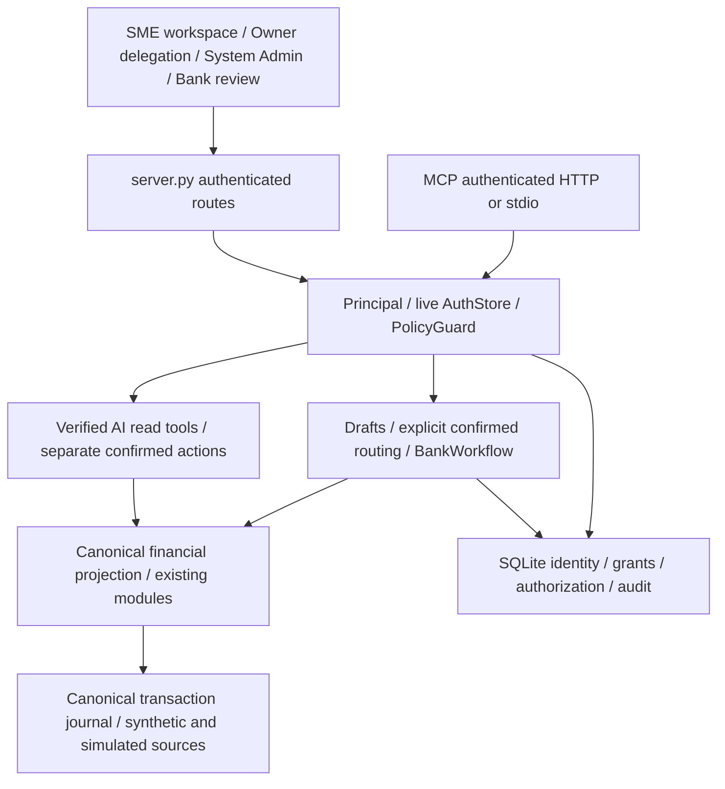

# Current technical architecture

The four-role security implementation extends the existing application; business formulas remain in their existing modules. The historical [prototype module design](MODULE_DESIGN.md) retains original formula/context descriptions but is not the current security reference.

| Component | Responsibility |
|---|---|
| `auth.py`, migrations 001–007 | Passwords, sessions, memberships, live authorization, recovery, migration and persistent audits |
| `authorization.py` | One four-role policy, compatibility resolution, immutable action bounds and category mapping |
| `security.py` | Principal, tier limits, permanent T4 denial, approval tokens, audit/guardrails |
| `server.py` | Route/API restrictions, cookie/CSRF/origin checks and role landing pages |
| `web/bank.html`, `bank.css`, `bank-components.js`, `bank-views.js`, `bank-portal.js` | Six-module Bank shell, pure presentation renderers and merchant-scoped authenticated AI/state adapter |
| `bank_workflow.py` | Owner delegation, scoped drafts, explicit Bank routing proposal, category-filtered review/export |
| `partner_state.py` | User/session/merchant-bound proposals, freshness and exact confirmation |
| `financial_data.py`, transaction journal/import services | Canonical recorded data projection and reconciliation |
| `verified_agent.py`, `reliability.py`, `tools_spec.py` | Permission-aware tools, typed evidence and verified/backend-rendered answers |
| `financing_journey.py` | Shared authorized five-step evidence, missing criteria and provisional incentive display |
| `modules/` | Existing dashboard, cash-flow, assessment, matching, RBF, reporting and payment calculations |

SQLite adds `financing_drafts` and `role_migration_history` without deleting merchant/application/audit history. Existing `consents` supports Bank authorization; `applications.recipient_id` protects packet routing. Staff delegation reuses `merchant_transaction_grants`. Financial journals, synthetic profile attributes and payment persistence are not replaced by this documentation/security change.

Bank review calls existing guarded capabilities, not an alternative underwriting engine. Historical aggregates/trends require report authorization; forecasts, assessment and financing are independently scoped. Final access checks and financial-version checks prevent returning changed/unauthorized evidence, but the stores do not form a distributed atomic snapshot.

See [security](SECURITY_PERMISSIONS.md), [Bank API](BANK_FINANCIAL_REVIEW.md), [POS ETL](POS_TRANSACTION_IMPORT.md), [AI](TASK03_FINANCIAL_PARTNER.md) and [limitations](KNOWN_LIMITATIONS.md).
