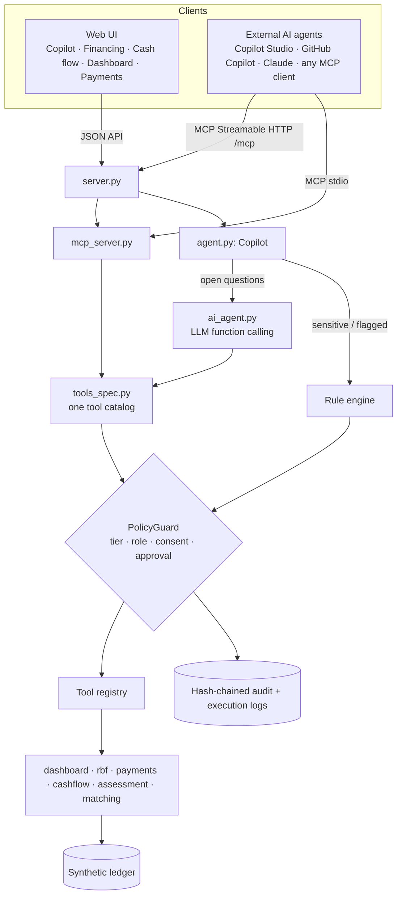

> **Historical snapshot — superseded.** Use [current documentation](../../README.md). Original evidence/scope is retained; old roles, menus, currency and setup instructions are not current policy.

# SME Finance Copilot: Prototype Module Design

> Historical snapshot: retained for chronology and original evidence. Role, consent, menu, API and test instructions below may be superseded. Use [current documentation](../../README.md) for the four-role baseline.

## 1. Design intent
The framework describes a **broken loop** between MSME business activity, the bank's visibility into it, interventions, and the business's upgrading. Its answer is a **closed-loop progression engine** built on **EQUIP**, **EXPAND** and **ENTICE**. This prototype puts that engine in the hands of the business owner as a copilot. It can be reached three ways: from the web UI, from an in-app AI agent, or from external AI agents over MCP.

## 2. Architecture

## 3. Modules
| Module | Core logic | Framework link |
|---|---|---|
| Merchant Intelligence Dashboard | Channel mix, trends, digital and own-rail capture, MoM own-rail growth, receivable timing vs. default | EQUIP dashboard; ENTICE tracker |
| Revenue-Based Financing | Advance ≤ 1.5 × verified monthly sales; fee 14/12/10% less milestone discount; remittance 6% + 12% × size, capped at 18%; payoff from replaying real daily sales | EQUIP RBF |
| Digital Payments Simulator | TLV payload with CRC; PENDING → PAID / EXPIRED / CANCELLED; idempotency; tiered MDR; settlement only on own rails; integrity flags | EQUIP payments; data-integrity risk |
| Cash-flow manager | Weekday-seasonal 8-week average plus scheduled items; prioritised alerts mapped to interventions | Business wallet |
| Assessment engine | Seven dimension scores with factors; composite → stage, capped by gate floors; succession → Stage 6; constraint diagnosis | Graduation Pipeline; Appendix H |
| Financing matcher | Hard filters, then 0.45 constraint fit + 0.25 stage fit + 0.15 readiness + 0.15 affordability; "why not yet" list | Phase 3: Finance & Scale |
| **AI agent (v1.1)** | LLM plans and calls up to 5 rounds of tools for the session merchant, then answers only from tool output; falls back to the rule engine | Conversational access to the whole loop |
| **MCP server (v1.1)** | JSON-RPC over stdio and Streamable HTTP; 11 tools with JSON Schemas and read-only hints; identity from configuration | Portability to other copilot platforms |

## 4. Agent loop
**Identify** the binding constraint → **Profile** behavioural and traditional signals → **Place** in a stage → **Activate** the EQUIP / EXPAND / ENTICE plan with ranked financing → **Measure & Graduate** against the previous snapshot.

## 5. Key design decisions
- **One tool catalog, one policy gate.** The web UI, in-app AI and external MCP agents all reach the modules through `Copilot.call()`. An AI client gets no more authority than the human it represents.
- **The model never chooses identity or merchant.** MCP identity comes from server configuration. In-app AI is pinned to the selected merchant.
- **Human-in-the-loop for consequential actions.** Applications need consent plus a single-use approval token in the web UI. Credit decisions stay with lenders.
- **Repayment comes from own-rail sales only.** This links RBF capacity to digital adoption, which closes the loop.
- **Customer payment delays are separated from merchant default.**
- **Anti-gaming** applies to milestones and payments.
- **Inclusion:** access never depends on owning a device, and early stages get low MDR.
