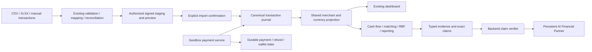
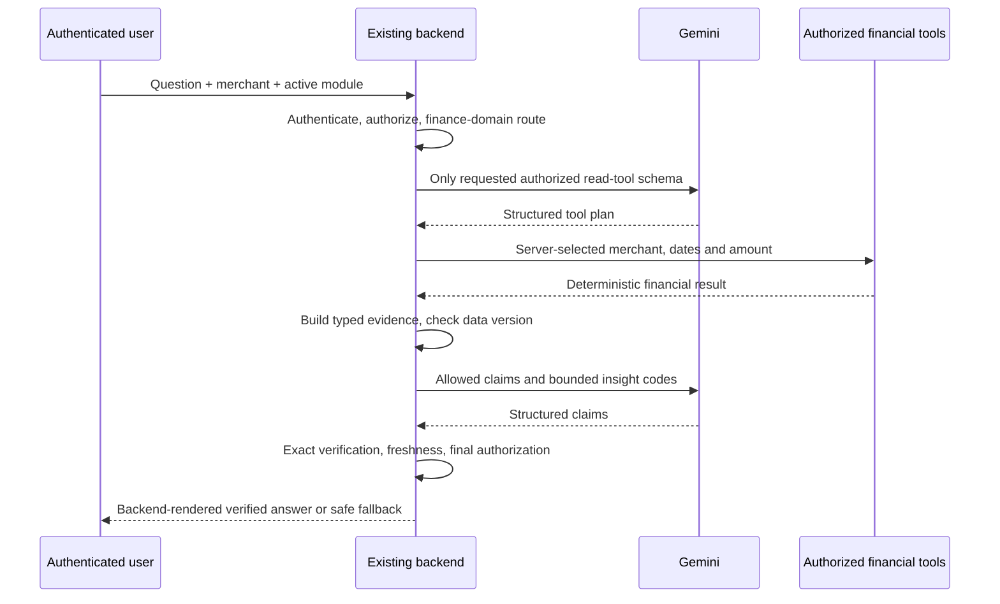

> **Historical snapshot — superseded.** Use [current documentation](../../README.md). Original evidence/scope is retained; old roles, menus, currency and setup instructions are not current policy.

# Task 03: AI Financial Partner

Current access rules: [four-role permissions](../../technical/security-permissions.md).

Implemented in the existing application on `feature/ai-financial-partner`, baseline
`32deb7034acd9e90b04011e9a7164c4a79adb6ba` (merged Task 02). Work is uncommitted;
no push, merge, production migration or live financial action was performed.
Task 03.1 Financial Survival Simulation is not implemented.

## Run locally

Open `C:\Users\User\source\repos\SMEFinance\sme-finance-copilot` in VS Code.
In its PowerShell terminal:

```powershell
python -m copilot.auth migrate
# Only on a fresh installation with no users; password is entered privately:
python -m copilot.auth bootstrap --username admin --email admin@example.test
$env:COPILOT_LLM_MODEL = "gemini-3.1-flash-lite"
python -m copilot.server --host 127.0.0.1 --port 8000
```

Open http://127.0.0.1:8000/login. Existing accounts/passwords remain unchanged.
Bootstrap is deliberately unavailable after the first user exists; use the existing
administrator account and User Administration to create business accounts.
Create a SME Owner with merchant membership, or a Staff account with explicit
transaction grants. A User/System Admin does not gain financial access.
Banks require membership, assignment and current category consent.
Owner financing consent remains at `/consents`; admin pages remain `/admin/users`
and `/admin/security`.

The only automatically loaded `.env` values are the four LLM settings. Process
variables override them. The local key and `.env` were preserved and are ignored
by Git. The owner’s `.env` still names its original model; the command above selects
the verified provisional model without editing the secret. Model availability is
provider/key dependent. A failed provider request displays deterministic fallback.
Do not paste credentials into chat, source, screenshots or reports.

## Architecture and financial data flow

The existing standard-library HTTP application, SQLite identity/policy store,
append-only transaction journal, MCP tools, PolicyGuard and financial modules are
retained. New migrations 005/006 are additive and preserve existing transaction
data. No replacement application or new frontend framework was introduced.



`financial_data.py` snapshots original synthetic inputs and projects validated
canonical records into the existing merchant model. Downstream tools and dashboard
reuse this projection and its data date. Saved manual/POS records are counted once,
even if legacy code also updated an in-memory merchant. Completed sales increase
recorded net sales; refunds/reversals reduce them; expenses are separate. Pending,
failed and voided records do not become revenue. Decimal aggregation retains cents.
Records in another currency fail validation instead of being silently combined.

Synthetic seed, historical POS, manual, simulated payment and mixed provenance are
explicit. Synthetic/demo data is not bank settlement evidence. Recorded net sales
are not wallet balance. Gross sales remain unknown when source components are absent;
the old compatible `mix.gross_revenue` API field now represents recorded net sales,
and the UI labels it accordingly. Dashboard volume counts sales/refund activity;
the report's completed transaction count also includes expense activity.
“This month” is anchored to the latest available business-data date, not an assumed
live trading date. Dates and limitations are shown in evidence.

## AI orchestration and verification



1. Finance-domain routing rejects unrelated requests and unavailable credit approvals.
   Guidance and generic education use bounded backend templates, not arbitrary prose.
2. Tool exposure intersects financial role boundaries, current permissions, merchant
   membership, consent and the configured tier ceiling. Analysis offers no write tool.
   The server fixes merchant/date/amount; model substitutions never change scope.
3. Financial functions remain authoritative. Gemini plans a permitted tool and copies
   the permitted claims; it cannot calculate final financial facts or authorize actions.
4. Every fact carries source, evidence ID, merchant, currency, metric, exact value,
   period, retrieval timestamp, provenance, quality, method version, record count,
   assumptions, limitations and classification.
5. Claims must match every typed field exactly; unsupported IDs, values, dates,
   currencies, merchants, statuses, free prose, extra fields and mixed fabricated claims
   reject the model response. Required findings cannot be omitted. Forecast evidence
   is ESTIMATED. VERIFIED means verified against authorized sandbox records, not a
   real-world lender certification. HYPOTHESIS is reserved in the schema; unsupported
   causal explanations are withheld rather than asserted.
6. Financial-data versions are checked around retrieval and explanation. Evidence
   expires after five minutes; changed records cause safe rejection/refresh. Live
   authorization runs again before publication. Missing/invalid provider configuration,
   invalid JSON, timeout or unsupported claims use verified deterministic rendering.
7. Only bounded backend-rendered labels and condition-checked insight codes reach the
   final financial answer. Imported descriptions, raw tool messages and raw supplied
   history are not model authority. There is no claim of universal injection resistance.

Reports include recorded totals, the existing repeat-recent-sales 30-day projection
and counts from existing cash-flow risk rules. Projections and rule alerts are marked
estimated. Forecast methods/assumptions are preserved. Match names come from the
configured product catalog; they are indicative, never lender approvals.

## Permissions, context and actions

Current authority is defined in [Security and permissions](../../technical/security-permissions.md). Staff financial reads/AI/drafts require explicit merchant delegation; Staff never submit. Bank reads authorized categories without a general case requirement, while submitted packets remain routed. System Admin has no financial AI access; unmapped roles are denied. Existing conversation freshness, typed evidence and exact action confirmation remain.

Owner submission must identify a Bank explicitly; use [Applications](../task04/9%20README_Financing.md) to create/edit a draft and review/confirm the exact proposal. No automatic first-consent routing or new Bank decision mutation is supported.


## Three-panel workspace

The existing shell now has left navigation, center workspace and persistent right
AI Financial Partner. Authorized Dashboard is the default landing view. Merchant
Transactions retains its four subviews. Digital Payments, Cash Flow and Financing
remain; Financing contains Overview, RBF Calculator and Applications. Old `/copilot`
and `/payment-sandbox` routes remain compatible. Direct routes, refresh, merchant
selection, logout and administrator navigation are preserved.

The AI panel collapses on desktop and becomes a focus-managed drawer on smaller
screens, closed automatically when crossing the mobile breakpoint. Module-specific
questions respect visible financial permissions. Evidence/status/fallback indicators
are explicit; past responses get a stale-data notice after changes. Tool names shown
after completion are actual executed tools; the pending message is not a fabricated
live tool trace.

## Verified defects changed

No lending fee or sizing coefficients were redesigned. A reproduced negative-sales
day produced a negative RBF repayment of -602.7; repayment is now bounded below by
zero. Nonpositive financial history no longer implies positive eligibility/limits,
and invalid capture ratios are rejected. Positive baseline regression retains the
10,000,000 advance, 1,300,000 fee and 11,300,000 total. Payment validation rejects
nonfinite/capped/overprecision amounts instead of accepting invalid floats. The MCP
RBF eligibility metadata now uses the same canonical projection as its quote.

## Testing and demo

Use [current isolated verification](TESTING.md) and [the four-role SME-to-Bank journey](SECURITY_SME_BANK_WORKFLOW.md). Earlier Task 03-specific defect and acceptance narratives are historical records, not fresh verification. Old auth/demo browser scripts may rely on superseded controls; the maintained browser entry point is `scripts/verify_four_role_browser.cjs`.

Optional `scripts/assess_partner.py` performs actual provider requests with synthetic data and locally configured secrets. It is not part of ordinary offline regression verification and was not executed for this documentation maintenance.

## Security self-assessment and risk register

| Risk or limit | Implemented control / remaining work |
|---|---|
| Model fabricates amounts, dates, references or approval | Exact typed equality, complete claims and backend rendering; finite tests do not prove all possible attacks |
| Cross-merchant/role leakage | Server principal, live permission/consent checks, fixed scope, session-bound actions; old displayed answers cannot be retroactively recalled |
| Imported instructions | Descriptions/raw tool prose excluded from explanation; numeric facts only; no external document/RAG parser |
| Stale evidence / concurrent changes | Data version and five-minute freshness, final reauthorization; no single distributed snapshot across all stores |
| Generic finance language | Conservative English routing and templates; incomplete multilingual/ambiguous intent support; no unrestricted finance conversation |
| Missing finance inputs | No FX, bank settlement, real credit score/limit/approval source; gross components can be unknown |
| Synthetic historical balances and obligations | Explicit provenance/limitations; forecasts may combine imported activity with synthetic base assumptions |
| Interrupted action | Durable CAS/idempotent outcomes; uncertain execution requires operator review |
| Provider failures | Safe deterministic fallback; availability, pricing and model lifecycle outside application control |
| Deployment | Local sandbox demonstration; not independently penetration-tested, externally deployed or certified for real lending |
| Presentation | No new dark-theme system; existing design retained, responsive tests run in Edge only |
| Hypotheses | Schema supports HYPOTHESIS but free causal hypotheses are intentionally not generated |

The pre-Task 03 Gemini baseline report/evidence is preserved as historical evidence;
its failures describe the baseline, not the current verified implementation.
